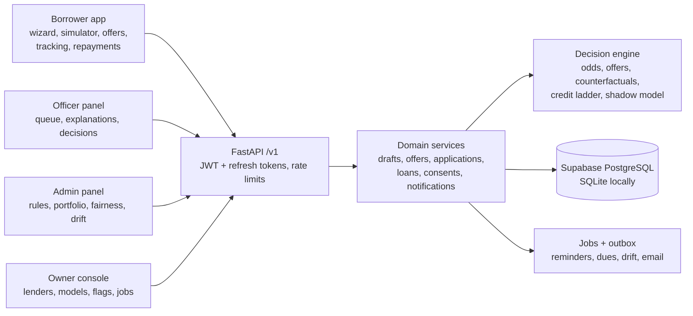
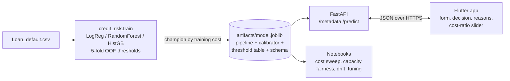

# LenDen: loan chances, offers and fair lending decisions, as a SaaS

**Borrowers see their chances of getting a loan in two minutes, what would improve them, and
estimated offers from every lender, then apply, track and repay. Lenders get a risk-sorted
queue with plain-language explanations, offer rules, a credit ladder, and fairness and drift
monitoring.**

LenDen is a multi-tenant platform built around a credit-default model. It started as a notebook
and grew into a product: an ML package, a FastAPI backend with four roles, and one Flutter app
(web + Android) in Bangla and English.

      

> Educational project on a public **synthetic** dataset. It does not lend money or pull real credit reports.

## What's new in v3

| Area | v2 | v3 |
|---|---|---|
| Borrower intake | One long form | 4-step wizard with autosave, no account needed to start, Bangla/English |
| Result | Traffic light + tips | Approval odds, live what-if simulator, the smallest change that improves the odds |
| Applying | Pick a lender, send the form | Estimated offers from every lender (amount and rate range, instalment), apply to one |
| Explanations | Top drivers | Reason codes + counterfactuals; declines carry reasons the borrower can read |
| After approval | Nothing | Loan, repayment schedule, (mock) payments, **credit ladder** (start small, grow) |
| Lender side | Queue, decide, settings | + claim/assign, SLA timers, document requests and uploads, offer rules, portfolio |
| Platform | Stats, lenders | + model registry with shadow scoring, feature flags, background jobs, funnel metrics |
| Model | Trained without Age | Trained **without age, marital status or dependants**: every monitored group now passes the 4/5ths rule |
| Engineering | One file per layer | Domain modules, versioned migrations, connection pool, refresh tokens, outbox, `/v1` API |

The full design is in the **LenDen v3 Architecture** document; [`CHANGELOG.md`](CHANGELOG.md) lists every change.

## Live demo

**[lenden-qydc.onrender.com](https://lenden-qydc.onrender.com)** hosts the web app (all four roles) and the API ([`/docs`](https://lenden-qydc.onrender.com/docs)).
It runs on Render's free tier, so the first visit after 15 idle minutes can take up to a minute to wake the server.

Log in with the one-tap demo chips on the login screen, or type an account below. **The password for every demo account is `demo1234`.**

| Role | Account | What to try |
|---|---|---|
| Borrower | `borrower1@demo.app` … `borrower200@demo.app` (mobile login: `01700000001` …) | Check your chances, move the simulator sliders, compare offers, apply, upload documents, repay, watch the credit level grow |
| Loan officer | `mahmud@greenfield.demo` | Claim from the queue, read reasons and the counterfactual, ask for documents, approve with terms or decline with reason codes |
| Lender admin | `admin@greenfield.demo` | Dashboard (SLA, odds mix, fairness, drift), portfolio and arrears, offer rules and ladder caps, team, activity log |
| Platform owner | `super@lenden.app` | Funnel and drop-off, lenders, model registry (shadow → active), feature flags, background jobs |

You can run the whole borrower check **without an account** from the landing page; your answers
carry over when you sign up. In the demo, one-time codes and reset links are shown on screen,
and only for demo accounts.

## The product



**Design choices**

- **Odds relative to each lender.** The label (excellent / good / fair / low) compares the risk
  score with that lender's own cost-optimal threshold, so it stays honest when a lender tightens
  policy. The officer queue still shows the calibrated probability and the traffic light.
- **Only actionable advice.** Tips and counterfactuals change only what a borrower controls (amount,
  term, co-signer, debt, rate), never who they are. Reason codes never cite protected attributes.
- **Start small, grow.** New borrowers start at level 1 (10% of a lender's maximum). Repaying on time
  unlocks 25%, 50% and 100%; a payment missed by 30 days drops a level.
- **Fairness by design.** The v2 model still failed the 4/5ths rule for marital status (0.76) and
  dependants (0.62). The v3 model drops both: worst ratio 0.94, for 0.2 points less savings
  (63.8% vs 64.0%). Optional, self-reported gender and age group are collected only to monitor
  approval rates and are never shown to officers or used for scoring.
- **Tenant isolation.** Every lender-owned row carries `org_id`; another lender's application,
  document or loan returns 404, and tests check it.
- **Human-in-the-loop and auditability.** The model only recommends. Declines need reason codes,
  every decision is on the application timeline and in an append-only audit log, and each
  application stores the model version that scored it.
- **Production-shaped.** Versioned migrations, pooled connections, rotating refresh tokens with
  reuse detection, idempotency keys, an outbox for notifications, and a model registry where a new
  model runs in shadow before it makes decisions.

---

## Research results (full-feature model, test set: 51,070 applications)

| | Approve everyone | Model (cost-optimal) | Model (30% review cap) |
|---|---|---|---|
| Expected loss | $59.31M | **$19.96M** | $27.62M |
| Savings | - | **$39.35M (66.4%)** | $31.69M (53.4%) |
| Defaults caught | 0% | 92.8% | 63.3% |
| Applications sent to review | 0% | 72.2% | 30.2% |

Costs assumed: **$10,000** per missed default, **$500** per good borrower wrongly sent to review.
Champion model: HistGradientBoosting (class-balanced), ROC AUC 0.758, PR AUC 0.330 (random = 0.116).

## What I found

1. **Accuracy is useless here.** "Approve everyone" scores 88% accuracy and loses $59M. Every model
   is judged in dollars instead.
2. **The cost ratio drives everything.** At 20:1, reviewing pays off whenever the chance of default
   is above **4.8%**, so the dollar-optimal rule reviews 72% of applicants. The model beats
   approve-everyone at every ratio from 2:1 to 50:1, but the operating point moves a lot.

   

3. **Review capacity has steep diminishing returns.** Reviewing the riskiest **20%** of applications
   captures **68%** of the maximum savings; **30% captures 81%**.

   

4. **The cost-optimal rule fails a fairness check.** Applicants aged 18-25 are approved 3.5% of the
   time versus 58% for ages 56-69, a disparate-impact ratio of **0.06** (the 4/5ths rule needs 0.80).
   Retraining **without `Age`** brings the worst ratio to **0.91 (passes)** for **+$1.4M (+7%)** in
   expected losses. The model's job is to make that trade-off visible; deciding it belongs to risk
   and compliance.

   

5. **Drift is detectable before defaults arrive.** A simulated downturn (incomes down 15%, rates up
   3 points, more young applicants) pushes Population Stability Index above 1.2 on two inputs and
   raises review volume from 72% to 86%.

   

6. **More tuning isn't the answer.** Randomised search improves test AUC by less than 0.001. The
   synthetic data caps the signal at about 0.76. Public notebooks reporting 0.99+ are leaking `LoanID`.

## ML pipeline



**Design choices worth noting**

- **No test-set leakage in decisions.** Thresholds and the champion are chosen on 5-fold
  *out-of-fold* training predictions; the test set is only used for reporting. HistGB and balanced
  LogReg are within 0.1% on training cost, so the champion can switch between scikit-learn versions.
  The Colab run of notebook 01 picked LogReg; `train.py` here picks HistGB.
- **Score versus probability.** Class weighting inflates raw scores, so an isotonic calibrator
  (fitted on OOF scores) turns them into an honest default probability for display (Brier 0.196 → 0.091).
- **Explanations without heavy dependencies.** Each prediction comes with its top 5 reasons. For each
  feature, the API measures how much the risk score changes when that feature is reset to a typical
  value. This works for any model in about 25 ms.
- **The app follows the model's schema.** The Flutter form is built from `/metadata`, so retraining with
  new ranges or categories needs no app update.

## App

One Flutter codebase for web and Android with feature modules (`lib/features/*`), Riverpod state,
go_router navigation with deep links, and English/Bangla strings (`tool/strings.py` generates both
tables). Phones get a bottom bar, wide screens a navigation rail. See
[`mobile/README.md`](mobile/README.md) for setup.

## Quick start

```bash
# 1. Setup
python -m venv .venv && source .venv/bin/activate      # Windows: .venv\Scripts\activate
pip install -r requirements.txt

# 2. Run the platform API (migrations + demo data on first start) -> http://localhost:8000/docs
uvicorn api.main:app --reload --host 0.0.0.0 --port 8000

# 3. Run the app (see mobile/README.md for first-time setup)
cd mobile && flutter run -d chrome

# 4. Tests (SQLite; set TEST_DATABASE_URL to run them on PostgreSQL too)
pytest -q
```

Useful commands (with `PYTHONPATH=src`):

| Command | What it does |
|---|---|
| `python -m lenden.migrate [--status]` | Apply (or list) database migrations |
| `python -m lenden.seed [--reset]` | Rebuild the demo data (`--reset` is required for PostgreSQL and deletes everything) |
| `python -m lenden.jobs --once` | Run every due background job once |
| `python -m lenden.jobs --run repayment_due` | Run one job now |

**Retrain the models** (needs `Loan_default.csv` from Kaggle `nikhil1e9/loan-default` in `data/`):

```bash
PYTHONPATH=src python -m credit_risk.train                                   # research model (all features)
PYTHONPATH=src python -m credit_risk.train --no-rf --exclude Age,MaritalStatus,HasDependents \
    --out artifacts/model_v3.joblib --metrics artifacts/metrics_v3.json      # platform model (v3)
```

A new artifact placed in `artifacts/` appears in the model registry as a candidate; promote it to
shadow, compare, then make it active from the owner console. Trained artifacts are included, so the
API runs without the dataset. Retrain if your scikit-learn version differs from 1.9.1.

### API overview (`/v1`, full docs at `/docs`)

| Area | Endpoints |
|---|---|
| Public | `GET /health` · `GET /metadata` · `GET /lenders` · `POST /readiness` · `POST /simulate` · `POST /emi` · `POST/GET/PUT/DELETE /drafts[/{id}]` · `GET /drafts/{id}/offers` |
| Auth | `POST /auth/register` · `/auth/login` · `/auth/refresh` · `/auth/logout` · `/auth/password/forgot` · `/auth/password/reset` · `/auth/otp/request` · `/auth/otp/verify` |
| Me | `GET/PUT /me` · `POST /me/password` · `/me/phone/request` · `/me/phone/verify` · `/me/2fa/setup|enable|disable` · `GET /me/consents` · `POST /me/consents/{id}/revoke` · `GET /me/export` · `POST /me/delete` · `GET /me/levels` · `GET /notifications` |
| Borrower | `GET /drafts` · `POST /applications` · `GET /applications/mine` · `GET /applications/{id}` · `POST /applications/{id}/withdraw` · `POST /applications/{id}/documents` · `GET /documents/{id}/link` · `GET /loans[/{id}]` · `POST /loans/{id}/repayments` |
| Officer | `GET /org/applications` · `GET /org/applications/{id}` · `POST …/claim` · `…/release` · `…/decision` · `…/document-requests` · `GET /org/dashboard` · `GET /org/loans[/{id}]` |
| Lender admin | `GET/PUT /org/settings` · `GET/PUT /org/offer-rules` · `GET/POST/PATCH /org/team` · `GET /org/portfolio` · `GET /org/fairness` · `GET /org/drift` · `GET /org/audit` |
| Platform owner | `GET /admin/stats` · `GET/POST/PATCH /admin/orgs` · `GET /admin/models` · `POST /admin/models/{id}/promote` · `GET /admin/models/{id}/shadow-report` · `GET/PUT /admin/flags` · `GET /admin/jobs` · `POST /admin/jobs/{name}/run` |

Errors always look like `{"code": "LADDER_LIMIT", "detail": "...", "fields": {...}}`; the apps translate
`code`. Writes that matter accept an `Idempotency-Key` header. v2 paths (without `/v1`) still work
for apps already installed.

### Deploy (free: Supabase + Render)

One Docker image builds the Flutter web app and serves it with the API, so the whole product lives
at **one URL**. Data lives in **Supabase PostgreSQL** (`DATABASE_URL`); without it the API falls back to
SQLite. Step-by-step guide: **[DEPLOY.md](DEPLOY.md)**.

## Project structure

```
├── api/
│   ├── main.py                     app, middleware (request id, security headers), error mapping
│   ├── deps.py · schemas.py        units of work, auth dependencies, idempotency, request bodies
│   └── routers/                    public · auth · borrower · staff · owner · files
├── src/lenden/                     SaaS platform (framework-free, fully tested)
│   ├── services.py                 Platform = all domain services together
│   ├── domain/                     identity · orgs · drafts · applications · loans · notifications
│   │                               privacy · insights · models (registry)
│   ├── db.py · migrate.py          SQLite / PostgreSQL adapter, pool, versioned migrations
│   ├── migrations/{sqlite,postgres}/  0001 v2 core · 0002 v3 · 0003 append-only history
│   ├── jobs.py · notifier.py       scheduler, outbox dispatch, reminders; email/SMS + bn/en templates
│   ├── security.py · ratelimit.py  passwords, JWT, refresh tokens, TOTP, signed links; rate limits
│   ├── storage.py                  local disk or Supabase Storage (private bucket)
│   └── seed.py · settings.py · clock.py · errors.py
├── src/credit_risk/                ML package
│   ├── odds.py · offers.py · counterfactual.py · reasons.py · ladder.py · scoring.py   (v3 engine)
│   └── train.py · service.py · readiness.py · explain.py · costs.py · fairness.py · monitoring.py
├── mobile/                         Flutter app (lib/app, core, shared, features/*), tool/strings.py
├── tests/                          85 pytest tests: engine, model checks, services, API, migrations
├── notebooks/                      01 core model, 02 cost, capacity, fairness, drift, tuning
├── artifacts/                      model_v3 (platform), model_fair (v2), model (research), metrics
├── Dockerfile · render.yaml · DEPLOY.md
└── .github/workflows/              ci.yml (SQLite + Postgres + Flutter), backup.yml (nightly pg_dump)
```

## Limitations and next steps

- **Synthetic data:** features are uniform and independent, so real credit data would behave
  differently, and amounts are in the dataset's units. Taka nano-loan ranges and alternative data
  (mobile-wallet history) need retraining on real data.
- **Mocked money and messages:** repayments are recorded, not collected; SMS is an interface only;
  email works with Resend or SMTP when configured.
- **Single instance:** rate limits and the job scheduler live in the web process (jobs are locked
  in PostgreSQL, so more instances are safe, but limits are per instance).
- **No time-based validation or reject inference:** both are standard in real credit scoring.
- **Costs are assumptions:** they should come from actual loss data and be refreshed quarterly.

---

*Built by [Mahmudul Hasan Joy](https://github.com/MahmudulHasanJoy).*
