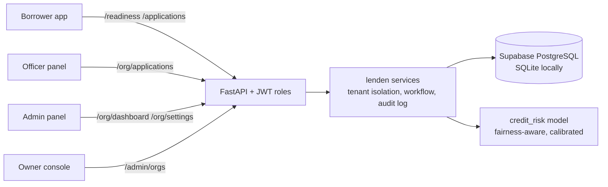
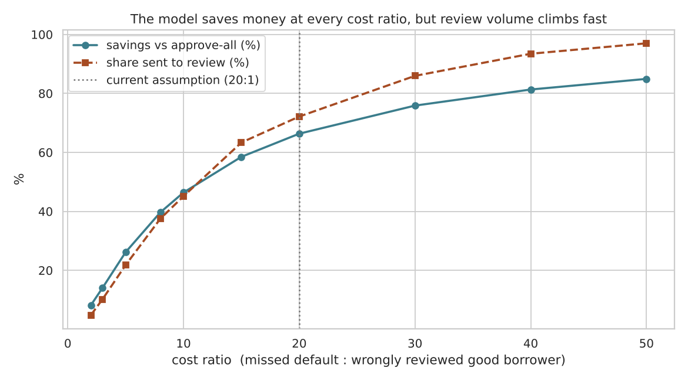
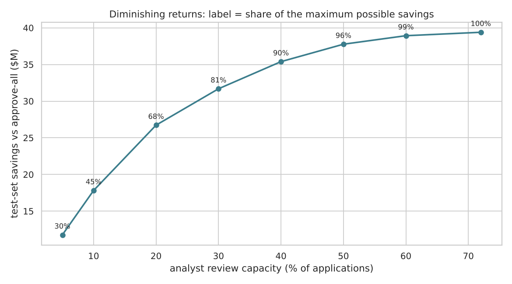
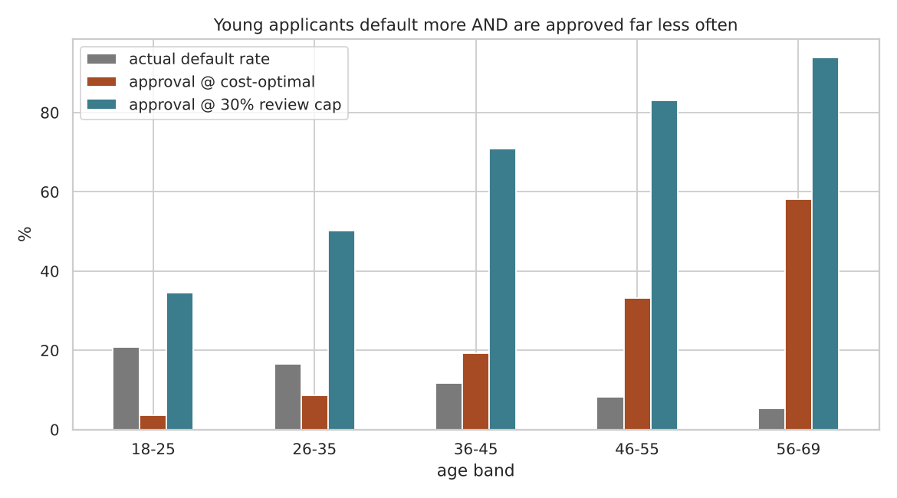
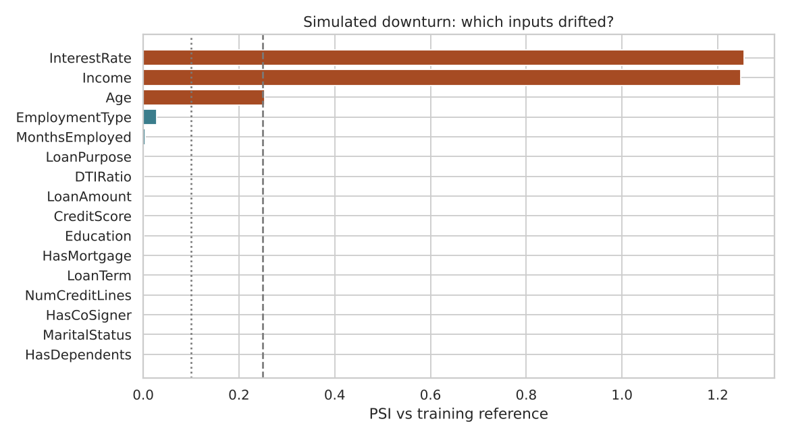
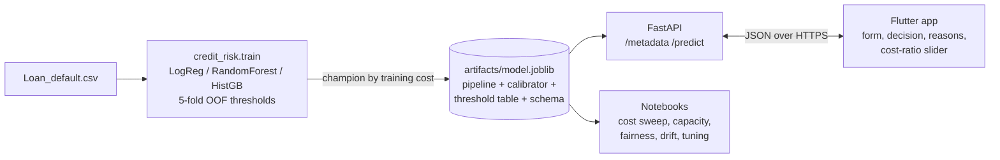

# LenDen: cost-aware, fairness-checked loan screening as a SaaS

**Borrowers find out if they are ready for a loan, and what to change, before they apply.
Lenders get a risk-sorted review queue with reasons, business-cost controls, and fairness and
drift monitoring.**

LenDen is a multi-tenant platform built around a credit-default model. It started as a
notebook and grew into a product: an ML package, a FastAPI backend with accounts and roles, and
one Flutter app that serves four roles.

      

> Educational project on a public **synthetic** dataset. Not a lending decision system.

## Live demo

**[lenden-qydc.onrender.com](https://lenden-qydc.onrender.com)** hosts the web app (all four roles) and the API ([`/docs`](https://lenden-qydc.onrender.com/docs)).
It runs on Render's free tier, so the first visit after 15 idle minutes can take up to a minute to wake the server.

Log in with the one-tap demo chips on the login screen, or type an account below. **The password for every demo account is `demo1234`.**

| Role | Email | What to try |
|---|---|---|
| Borrower | `borrower1@demo.app` (up to `borrower200@demo.app`) | Readiness check, "Try it" tips, apply to a lender, track the decision |
| Loan officer | `mahmud@greenfield.demo` | Risk-sorted queue, reasons, approve / ask for documents / reject |
| Lender admin | `admin@greenfield.demo` | Dashboard, fairness and drift monitors, decision rules, team, activity log |
| Platform owner | `super@lenden.app` | Lender organisations, plans, platform totals |

You can also run a readiness check **without an account** from the landing page.

## The product

| Role | What they do |
|---|---|
| **Borrower** (free, mobile) | Readiness check with a 🟢🟡🔴 light → concrete tips ("borrow 60,000 instead of 120,000", "add a co-signer") with one-tap re-check → affordability / EMI → apply to a lender with consent → track the decision and the lender's message |
| **Loan officer** (web / tablet) | Queue sorted by risk → model recommendation (APPROVE / REVIEW), default probability and the top reasons → approve, ask for documents, or reject with a reason. **A person always decides.** |
| **Lender admin** | KPIs, readiness mix, trend, **fairness monitor** (4/5ths rule by marital status and dependents), **drift monitor** (PSI), decision rules (cost ratio, review cap), team, activity log |
| **Platform owner** | Lender organisations (tenants), plans, platform totals, suspend / reactivate lenders |



**Platform design choices**

- **Ships the fairness-aware model.** Notebook 02 showed the dollar-optimal model fails the 4/5ths
  rule by age (ratio 0.06). The platform model is trained **without `Age`**: every age band is now at
  0.91 or above, for 2 points less savings (64% vs 66%).
- **Two views of one model.** Borrowers see a light and *actionable* tips. Tips only touch what a
  borrower can change (amount, term, co-signer, debt, rate), never who they are. Officers see the
  calibrated probability, threshold and reasons.
- **Tenant isolation.** Every lender-owned row carries `org_id`. Officers asking for another
  lender's application get a 404, not a 403, so nothing leaks. This is covered by tests.
- **Human-in-the-loop and auditability.** The model only recommends. Rejections require a reason
  shown to the borrower, and every decision and settings change goes to an audit log.
- **Honest monitoring.** Drift (PSI) is withheld until 100 applications, because on small samples
  stable data still scores around 0.15 from noise alone.

---

## Research results (full-feature model, test set: 51,070 applications)

| | Approve everyone | Model (cost-optimal) | Model (30% review cap) |
|---|---|---|---|
| Expected loss | $59.31M | **$19.96M** | $27.62M |
| Savings | - | **$39.35M (66.4%)** | $31.69M (53.4%) |
| Defaults caught | 0% | 92.8% | 63.3% |
| Applications sent to review | 0% | 72.2% | 30.2% |

Costs assumed: **$10,000** per missed default, **$500** per good borrower wrongly sent to review.
Champion model: HistGradientBoosting (class-balanced), ROC AUC 0.758, PR AUC 0.330 (random = 0.116).

## What I found

1. **Accuracy is useless here.** "Approve everyone" scores 88% accuracy and loses $59M. Every model
   is judged in dollars instead.
2. **The cost ratio drives everything.** At 20:1, reviewing pays off whenever the chance of default
   is above **4.8%**, so the dollar-optimal rule reviews 72% of applicants. The model beats
   approve-everyone at every ratio from 2:1 to 50:1, but the operating point moves a lot.

   

3. **Review capacity has steep diminishing returns.** Reviewing the riskiest **20%** of applications
   captures **68%** of the maximum savings; **30% captures 81%**.

   

4. **The cost-optimal rule fails a fairness check.** Applicants aged 18-25 are approved 3.5% of the
   time versus 58% for ages 56-69, a disparate-impact ratio of **0.06** (the 4/5ths rule needs 0.80).
   Retraining **without `Age`** brings the worst ratio to **0.91 (passes)** for **+$1.4M (+7%)** in
   expected losses. The model's job is to make that trade-off visible; deciding it belongs to risk
   and compliance.

   

5. **Drift is detectable before defaults arrive.** A simulated downturn (incomes down 15%, rates up
   3 points, more young applicants) pushes Population Stability Index above 1.2 on two inputs and
   raises review volume from 72% to 86%.

   

6. **More tuning isn't the answer.** Randomised search improves test AUC by less than 0.001. The
   synthetic data caps the signal at about 0.76. Public notebooks reporting 0.99+ are leaking `LoanID`.

## ML pipeline



**Design choices worth noting**

- **No test-set leakage in decisions.** Thresholds and the champion are chosen on 5-fold
  *out-of-fold* training predictions; the test set is only used for reporting. HistGB and balanced
  LogReg are within 0.1% on training cost, so the champion can switch between scikit-learn versions.
  The Colab run of notebook 01 picked LogReg; `train.py` here picks HistGB.
- **Score versus probability.** Class weighting inflates raw scores, so an isotonic calibrator
  (fitted on OOF scores) turns them into an honest default probability for display (Brier 0.196 → 0.091).
- **Explanations without heavy dependencies.** Each prediction comes with its top 5 reasons. For each
  feature, the API measures how much the risk score changes when that feature is reset to a typical
  value. This works for any model in about 25 ms.
- **The app follows the model's schema.** The Flutter form is built from `/metadata`, so retraining with
  new ranges or categories needs no app update.

## App

One Flutter codebase for Android, iOS and web, with a custom design system (Inter, teal brand,
outlined cards, light and dark mode). Staff get a SaaS sidebar on wide screens and a bottom bar on
phones. See [`mobile/README.md`](mobile/README.md) for setup and demo logins.

## Quick start

```bash
# 1. Setup
python -m venv .venv && source .venv/bin/activate      # Windows: .venv\Scripts\activate
pip install -r requirements.txt

# 2. Run the platform API (demo data is created on first start) -> http://localhost:8000/docs
uvicorn api.main:app --reload --host 0.0.0.0 --port 8000

# 3. Run the app (see mobile/README.md for first-time setup)
cd mobile && flutter run -d chrome

# 4. Tests
pytest -q
```

Demo logins (password `demo1234`): `borrower1@demo.app`, `mahmud@greenfield.demo` (officer),
`admin@greenfield.demo` (admin), `super@lenden.app` (owner). Reset the demo data with
`PYTHONPATH=src python -m lenden.seed`.

**Retrain the models** (needs `Loan_default.csv` from Kaggle `nikhil1e9/loan-default` in `data/`):

```bash
PYTHONPATH=src python -m credit_risk.train                                   # research model (all features)
PYTHONPATH=src python -m credit_risk.train --no-rf --exclude Age \
    --out artifacts/model_fair.joblib --metrics artifacts/metrics_fair.json   # platform model
```

Trained artifacts are included, so the API runs without the dataset. Retrain if your
scikit-learn version differs from 1.9.1.

### API overview (full docs at `/docs`)

| Area | Endpoints |
|---|---|
| Public | `GET /health` · `GET /metadata` · `GET /lenders` · `POST /readiness` · `POST /emi` |
| Auth | `POST /auth/register` · `POST /auth/login` · `GET /me` |
| Borrower | `POST /applications` · `GET /applications/mine` |
| Officer | `GET /org/applications` · `GET /org/applications/{id}` · `POST /org/applications/{id}/decision` · `GET /org/dashboard` |
| Lender admin | `GET/PUT /org/settings` · `GET/POST /org/team` · `PATCH /org/team/{id}` · `GET /org/audit` |
| Platform owner | `GET /admin/stats` · `GET/POST /admin/orgs` · `PATCH /admin/orgs/{id}` |

### Deploy (free: Supabase + Render)

One Docker image builds the Flutter web app and serves it together with the API, so the whole
product lives at **one URL**. Data lives in **Supabase PostgreSQL** (`DATABASE_URL`); locally,
without `DATABASE_URL`, it falls back to SQLite. Full step-by-step guide: **[DEPLOY.md](DEPLOY.md)**.

- `render.yaml` blueprint: Render asks for the Supabase URI and generates the JWT secret
- Tables are created on first start, with row-level security on (Supabase's public REST API is blocked)
- Demo data is seeded in the background on an empty database
- CI runs the full test suite on **SQLite and PostgreSQL 16**, plus the Flutter web build

## Project structure

```
├── api/main.py                     FastAPI app: routes per role, JWT auth, error mapping
├── src/lenden/                  SaaS platform (framework-free, fully unit-tested)
│   ├── services.py                 accounts, applications, decisions, dashboards, tenants
│   ├── db.py                       SQLite / PostgreSQL (Supabase) adapter, schema, RLS
│   ├── security.py                 PBKDF2 password hashing, JWT, role checks
│   ├── seed.py                     demo lenders, staff and 200 borrowers
│   └── settings.py                 environment configuration
├── src/credit_risk/                ML package
│   ├── train.py                    OOF thresholds, champion selection, --exclude for fair model
│   ├── service.py                  scoring + input validation
│   ├── readiness.py                traffic light, actionable what-if tips, EMI / affordability
│   ├── explain.py · costs.py · fairness.py · monitoring.py · models.py · data.py · config.py
├── notebooks/
│   ├── 01_credit_default_risk.ipynb   EDA → models → thresholds → calibration → SHAP
│   └── 02_extensions.ipynb            cost sweep, capacity, fairness, drift, tuning
├── mobile/                         Flutter app (borrower, officer, admin, owner)
├── tests/                          33 pytest tests: model, platform services, API
├── artifacts/                      model.joblib (research), model_fair.joblib (platform), metrics
├── reports/figures/                charts used above
├── Dockerfile                      multi-stage: Flutter web build + API image
├── render.yaml · DEPLOY.md         Render blueprint + Supabase deploy guide
└── .github/workflows/ci.yml        pytest on SQLite + Postgres, Flutter analyze/test/build
```

## Limitations and next steps

- **Platform:** the next steps for production are migrations (Alembic), a connection pool for
  multiple workers, refresh tokens, rate limiting, email verification and notifications.
- **Synthetic data:** features are uniform and independent, so real credit data would behave
  differently. Next: validate the pipeline on Home Credit or Lending Club data.
- **No time-based validation or reject inference:** both are standard in real credit scoring.
- **Costs are assumptions:** they should be estimated from actual loss data and refreshed quarterly.
- **Fairness:** the platform model still flags marital status at some lenders. Dropping a feature is the bluntest mitigation. Next: compare reweighing and
  constraint-based training (e.g. Fairlearn), and audit intersections such as age × marital status.

---

*Built by [Your Name](https://github.com/your-username). Replace with your name and links.*
